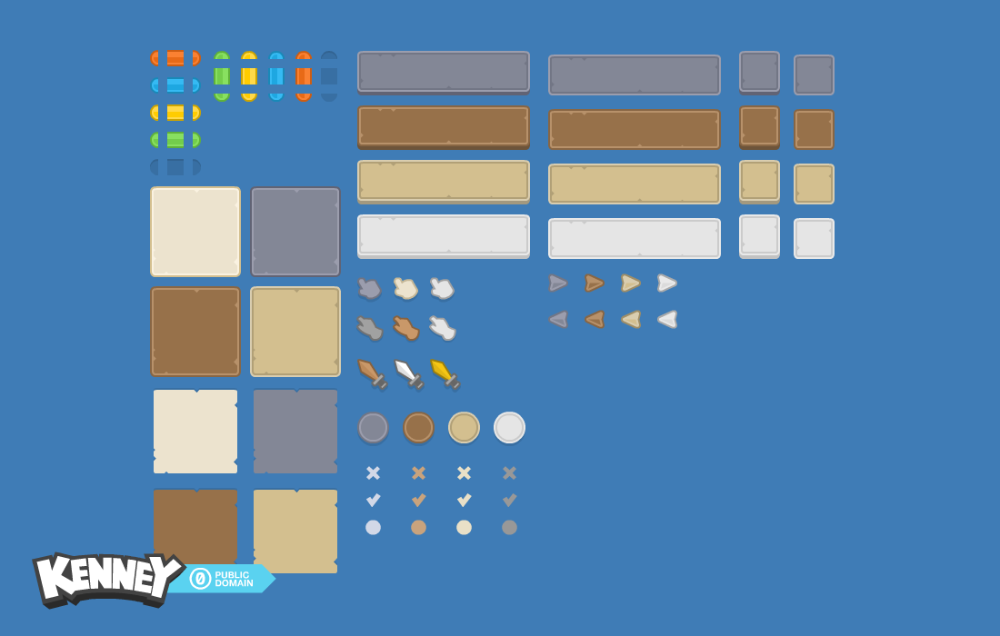

# JavaFX Card Battle Game

A small single-player card battle game written in **Java 21 + JavaFX**, built as the
semester project for Object-Oriented Programming at FIIT STU.



## What it does

- Choose a hero: **Warrior**, **Mage** or **Thief**, each with different stats.
- Fight three enemy tiers: **Goblin -> Necromancer -> Boss**.
- Build and play a deck of **Attack / Heal / Mana / Random** cards.
- Earn gold, buy card and character upgrades in the **shop**.
- Save and load progress through Java serialization (`savegame.dat`).
- Enemy turns run on a background thread so the UI stays responsive.

## Tech stack

- Java 21
- JavaFX (UI, CSS styling, FXML-style views built in code)
- Java `java.util.logging` for game logs
- Java serialization for save states
- MVC-style separation: `Characters`, `Cards`, `Deck`, `GameControl`, `GUI`, `Shop`

## Architecture

```
src/
├── Cards/          card types and level-ups
├── Characters/     heroes and enemies
├── Deck/           deck and deck factory
├── GameControl/    GameController, GameState
├── GUI/            main menu, character select, game board, shop
├── Shop/           upgrades and purchases
├── Exceptions/     custom checked exception
├── Utils/          logger
└── main/           JavaFX entry point
```

`GameController` owns the turn logic; `GameState` is a serializable snapshot; the GUI
only renders state and forwards actions.

## How to run

You need JDK 21 and a JavaFX 21 SDK.

### Windows (PowerShell)

```powershell
$javafx  = "C:\javafx-sdk-21.0.10\lib"
$sources = Get-ChildItem -Recurse src -Filter *.java | ForEach-Object FullName

javac --module-path $javafx --add-modules javafx.controls,javafx.fxml `
      -d out $sources

java --module-path $javafx --add-modules javafx.controls,javafx.fxml `
     -cp "out;src" main.Main
```

`src` is on the runtime classpath so the `/assets/...` images can be loaded.

### Linux / macOS

```bash
JAVAFX=/path/to/javafx-sdk-21.0.10/lib

javac --module-path "$JAVAFX" --add-modules javafx.controls,javafx.fxml \
      -d out $(find src -name "*.java")

java --module-path "$JAVAFX" --add-modules javafx.controls,javafx.fxml \
     -cp "out:src" main.Main
```

## What I learned

- Structuring a larger Java application around MVC instead of one god-class.
- Using interfaces and polymorphism for cards, characters and upgrades.
- Handling background work and UI updates with JavaFX.
- Persisting object graphs with serialization and versioning them safely.

## Author

Ondrej Nebus — FIIT STU, 2025/26.
